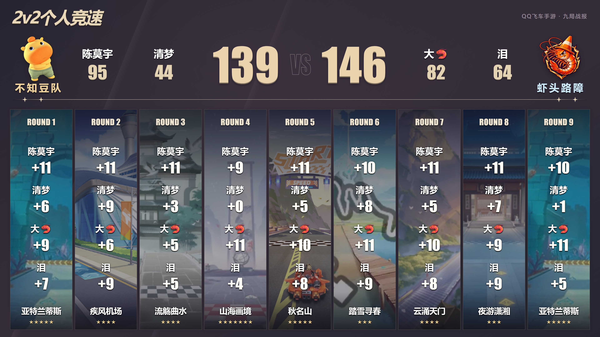
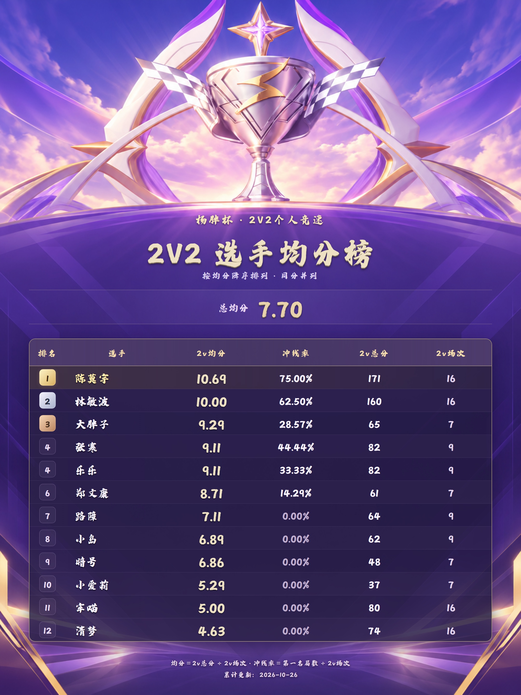

<div align="center">

# 杨胖杯 · QQ飞车手游赛事图鉴

**战报设计 · 选手均分榜 · 队伍视觉 · 制作方法**

面向赛事组织者、飞车玩家和海报制作者的参考项目。成图直接展示，数据、模板与素材一并提供，方便查看设计，也方便换成自己的比赛数据。

[看战报](#战报展示) · [看均分榜](#选手均分榜) · [看队标](#六支队伍与队标) · [动手制作](docs/制作指南.md) · [赛道图库](docs/赛道图库.md)

</div>

## 战报展示

### 宇宙胖猴 VS 波喵 · 113 : 94

**2026-10-26 更新 · 七局战报**

[](outputs/杨胖杯_2026-10-26_宇宙胖猴VS波喵/宇宙胖猴VS波喵_杨胖杯%20·%20七局战报_4K.png)

**宇宙胖猴**：大胖子 65、暗号 48　｜　**波喵**：沐瑞 70、喵帕斯 24

[高清 PNG](outputs/杨胖杯_2026-10-26_宇宙胖猴VS波喵/宇宙胖猴VS波喵_杨胖杯%20·%20七局战报_4K.png) · [发送版 JPG](outputs/杨胖杯_2026-10-26_宇宙胖猴VS波喵/宇宙胖猴VS波喵_杨胖杯%20·%20七局战报_4K.jpg) · [本场数据 JSON](yangpang/matches/2026-10-26_宇宙胖猴VS波喵.json)

### 不知豆队 VS 爱康tv · 106 : 98

**2026-10-26 更新 · 七局战报**

[](outputs/杨胖杯_2026-10-26/不知豆队VS爱康tv_杨胖杯%20·%20七局战报_4K.png)

**不知豆队**：陈莫宇 76、清梦 30　｜　**爱康tv**：郑文康 61、小爱莉 37

[高清 PNG](outputs/杨胖杯_2026-10-26/不知豆队VS爱康tv_杨胖杯%20·%20七局战报_4K.png) · [发送版 JPG](outputs/杨胖杯_2026-10-26/不知豆队VS爱康tv_杨胖杯%20·%20七局战报_4K.jpg) · [本场数据 JSON](yangpang/matches/2026-10-26_不知豆队VS爱康tv.json)

### 波喵 VS 寒岛 · 146 : 144

深紫底色配香槟金比分，上方集中呈现队伍与选手总分，下方按九局顺序排列赛道竖卡。真实游戏场景叠加暗色蒙层，保证分数清晰。

[](outputs/波喵VS寒岛_九局战报_4K.png)

**波喵**：沐瑞、喵帕斯　｜　**寒岛**：张寒、岛

[高清 PNG](outputs/波喵VS寒岛_九局战报_4K.png) · [发送版 JPG](outputs/波喵VS寒岛_九局战报_4K.jpg) · [本场数据 JSON](yangpang/matches/波喵VS寒岛.json)

### 不知豆队 VS 虾头路障 · 139 : 146

复用同一套版式，替换阵容、队标、赛道与每局分数。不知豆队使用绿色秋裤人物队标；第四局的零分明确显示为「+0」。

[](outputs/不知豆队VS虾头路障_九局战报_4K-v3.png)

**不知豆队**：陈莫宇、清梦　｜　**虾头路障**：大🦐、泪

[高清 PNG](outputs/不知豆队VS虾头路障_九局战报_4K-v3.png) · [发送版 JPG](outputs/不知豆队VS虾头路障_九局战报_4K-v3.jpg) · [本场数据 JSON](yangpang/matches/不知豆队VS虾头路障.json)

四张战报尺寸均为 **3840 × 2160**。点击图片可打开高清原图。

## 选手均分榜

**最新累计：2026-10-26 · 12 名选手 · 4 场对阵**

竖版以奖杯、旗帜与紫金光影衬托榜单。按累计均分降序排列，同分并列；总均分为总得分除以选手参赛局数之和，本期为 **986 ÷ 128 = 7.70**。

<div align="center">
  <a href="outputs/杨胖杯_2026-10-26_宇宙胖猴VS波喵/杨胖杯_2v均分榜_更新.png"></a>
</div>

**2160 × 2880** · 字魂白鸽天行体 · 总均分 **7.70**

[高清 PNG](outputs/杨胖杯_2026-10-26_宇宙胖猴VS波喵/杨胖杯_2v均分榜_更新.png) · [发送版 JPG](outputs/杨胖杯_2026-10-26_宇宙胖猴VS波喵/杨胖杯_2v均分榜_更新.jpg) · [榜单数据](yangpang/average-ranking/ranking-data.json) · [排版脚本](yangpang/average-ranking/build-ranking.cjs)

战报中的沐瑞、喵帕斯分别累计到原榜的“林敏波、牢喵”；本榜沿用历史显示名。第一名局数、总分和参赛局数累计计算，0分局仍计入场次。

历史快照：[最初8人榜](outputs/杨胖杯_2v均分榜_白鸽天行体.png) · [爱康tv参赛后10人榜](outputs/杨胖杯_2026-10-26/杨胖杯_2v均分榜_2026-10-26.png) · [累计记录](yangpang/average-ranking/history/)

## 六支队伍与队标

六枚队标均为透明背景 PNG，可以放进战报、赛程图或对阵海报。点击队标查看原图。

<table>
  <tr>
    <td align="center" width="33%"><a href="yangpang/qqspeed-battle-report/assets/bomiao-logo.png"></a><br><b>波喵</b><br>沐瑞 · 喵帕斯<br><sub>橙色加菲猫徽章</sub></td>
    <td align="center" width="33%"><a href="yangpang/qqspeed-battle-report/assets/handao-logo.png"></a><br><b>寒岛</b><br>张寒 · 岛<br><sub>冰蓝色岛屿与雪峰</sub></td>
    <td align="center" width="33%"><a href="yangpang/qqspeed-battle-report/assets/buzhidou-logo.png"></a><br><b>不知豆队</b><br>陈莫宇 · 清梦<br><sub>黄色人物与绿色秋裤</sub></td>
  </tr>
  <tr>
    <td align="center"><a href="yangpang/qqspeed-battle-report/assets/xiatou-luzhang-logo.png"></a><br><b>虾头路障</b><br>大🦐 · 泪<br><sub>大虾与路障锥帽</sub></td>
    <td align="center"><a href="yangpang/qqspeed-battle-report/assets/yuzhou-panghou-logo.png"></a><br><b>宇宙胖猴</b><br>暗号 · 大胖子<br><sub>胖猴宇航员与行星环</sub></td>
    <td align="center"><a href="yangpang/qqspeed-battle-report/assets/aikang-tv-logo.png"></a><br><b>爱康tv</b><br>郑文康 · 小爱莉<br><sub>动漫人物与上下交错手势</sub></td>
  </tr>
</table>

[队伍登记 JSON](yangpang/teams.json) · [队标说明](yangpang/qqspeed-battle-report/references/team-logos.md) · [新增队标的完整提示词](outputs/杨胖杯_队标/队伍登记与设计记录.json)

## 怎样制作自己的战报

1. 准备两队各两名选手的逐局分数和地图顺序。
2. 复制示例 JSON，替换队名、选手、透明队标路径和每局得分。
3. 运行渲染器，检查全部逐局分数与总分，再导出 PNG 和 JPG。

```bash
git clone https://github.com/murui-l/yangpang-cup.git
cd yangpang-cup
npm install
npx playwright install chromium

npm run report -- --config "yangpang/matches/波喵VS寒岛.json" --out-dir outputs --work-dir work/demo
```

仓库已附四场示例使用的 **18 张地图原图、缩略图及来源索引**，克隆后可以直接重制示例。地图使用和新增方法见 [赛道图库](docs/赛道图库.md)。

均分榜可运行 `npm run ranking`。完整参数、数据格式、字体调整及常见问题见 [制作指南](docs/制作指南.md)。

## 设计与数据处理方法

| 环节 | 做法 |
|---|---|
| 版面 | 固定 HTML/CSS 排版，比分和姓名由 JSON 注入 |
| 队标 | 根据队名或人物参考制作，导出透明 PNG |
| 赛道 | 按地图名称读取真实场景，重复地图复用同一素材 |
| 校验 | 逐局累加个人分数、再汇总队分；检查缺图、漏局与文字溢出 |
| 输出 | 战报 3840×2160；均分榜 2160×2880；每张同时导出 PNG/JPG |

图像生成用于队标和装饰背景；准确的文字与分数通过排版脚本绘制。这种分工方便核对数据，也便于替换选手和比分后反复制作。

## 文件导航

```text
outputs/                         成图与设计记录
maps/                            示例赛道图、缩略图和来源索引
docs/                            面向读者的制作指南与赛道图库
yangpang/
  teams.json                     六支队伍登记
  matches/                       四场比赛的原始比分配置
  average-ranking/               均分榜脚本、数据、背景与字体
  qqspeed-battle-report/          战报模板、渲染器、队标与技能参考
```

## 素材与使用说明

本项目供赛事视觉和数据排版学习参考。赛道的实际出处记录在 [maps/catalog.json](maps/catalog.json)，队标和背景的制作过程记录在 `outputs/` 的说明文件中。游戏场景、角色参考与字体分别保留各自权利，不因仓库公开而获得额外商用授权；所附白鸽天行体文件标注「商用需授权」。

发现比分、显示名或素材对应问题，欢迎 [提交 Issue](https://github.com/murui-l/yangpang-cup/issues)，请附上具体场次或文件名。也欢迎分享自己的排版改进和战报效果。
